<p align="center">
  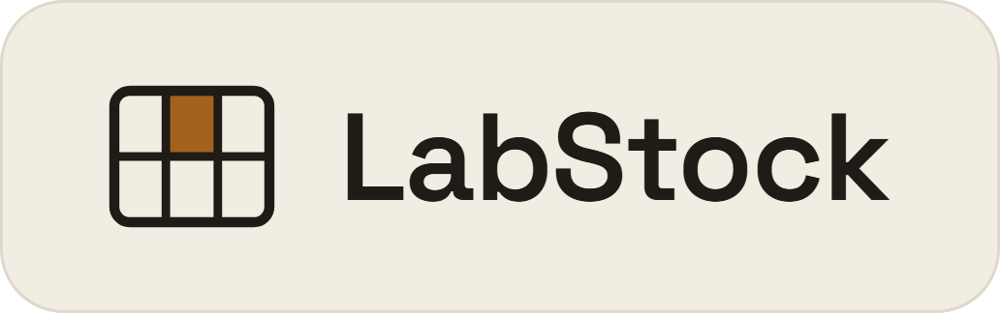
</p>

<p align="center"><b>English</b> · <a href="README.tr.md">Türkçe</a></p>

<h3 align="center">Never ask “which drawer was that resistor in?” again.</h3>

<p align="center">
  A free inventory app for electronic components — it knows which box every part
  is in and how many are left, prints QR labels, fills in part data from LCSC codes
  and shop links, counts parts with your phone camera, and answers questions about
  your stock with an AI assistant.
</p>

<p align="center">
  <a href="https://github.com/recepuysal/labstock/releases/latest"></a>
  <a href="https://github.com/recepuysal/labstock/releases"></a>
  
  
  
  
</p>

<p align="center">
  <a href="https://github.com/recepuysal/labstock/releases/latest/download/LabStock-Kurulum.exe">
    <strong>⬇ Download for Windows</strong>
  </a>
  ·
  <a href="#linux">⬇ Linux (AppImage / .deb)</a>
  ·
  <a href="https://app.labstock.com.tr"><strong>🚀 Try in browser</strong></a>
  ·
  <a href="https://labstock.com.tr">🌐 labstock.com.tr</a>
  ·
  <a href="#screenshots">Screenshots</a>
  ·
  <a href="#feedback--contact">Feedback</a>
</p>

<p align="center">
  <picture>
    <source media="(prefers-color-scheme: dark)" srcset="docs/screenshots/hero-koyu-en.png">
    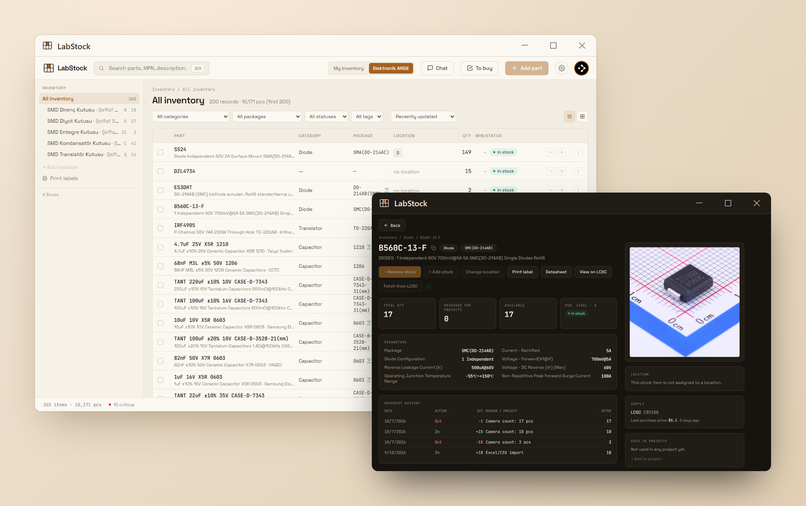
  </picture>
</p>

<p align="center">
  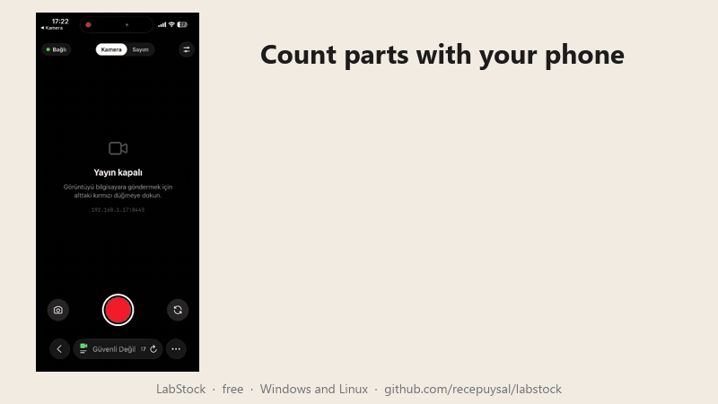<br>
  <sub>Pour parts on the table, count them with your phone camera, write the count to LabStock — <a href="#count-parts-with-your-phone-camera-desktop-app">how it works</a></sub>
</p>

## Why LabStock?

Anyone who does electronics as a hobby or runs a small production workshop ends
up asking the same question: *“Which drawer was that resistor in?”* LabStock
maps your parts to their physical locations (room › cabinet › drawer ›
compartment), then lets you search, filter, print QR labels and bulk-import from
Excel. After installation it updates itself silently on every launch — there's
nothing to maintain.

| | |
|---|---|
| 📦 **Location tree** — room › cabinet › drawer › bin | 🔎 **Instant search** — part, MPN, description |
| 🏷️ **QR labels** — print, stick, scan | ⚡ **Fetch from LCSC or a shop link** — the form fills itself |
| 💬 **Chat assistant** — ask “what do I have?” | 📱 **Count parts with your phone camera** — no app to install |
| 📊 **Excel import / export** | 👥 **Viewers** — share your inventory read-only |
| 🌙 **Dark / light theme** | 🔄 **Silent auto-update** |
| 🌍 **English and Turkish interface** | 🆓 **Free** |
| 🤖 **Free AI keys + daily usage bar** — Gemini, Groq, OpenRouter | 🛒 **Microsoft Store** — coming soon (in certification) |

## Screenshots

These screenshots come from a real R&D lab inventory with 265 part types and
more than 10,000 components. If you use GitHub in dark mode, you'll see the
dark-theme versions.

### Location tree and parts list
A hierarchical location tree (room › cabinet › drawer › compartment). Filter the
parts list by location, category, package, status and tag, and switch between
list and grid views. The status bar always shows the number of part types, total
quantity, critical items and the estimated inventory value.

<p align="center">
  <picture>
    <source media="(prefers-color-scheme: dark)" srcset="docs/screenshots/envanter-izgara-koyu-en.png">
    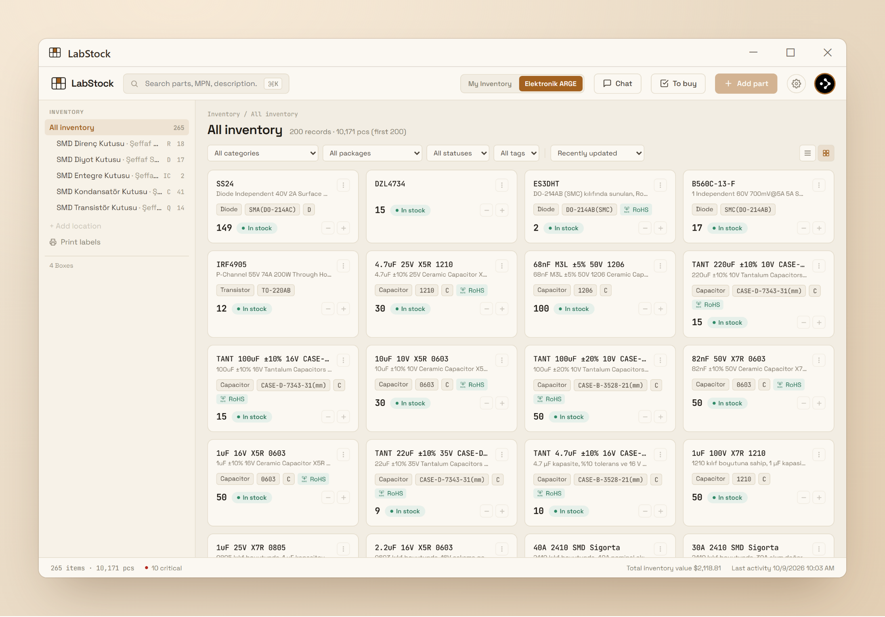
  </picture>
</p>

Click a box to see only what's inside it:

<p align="center">
  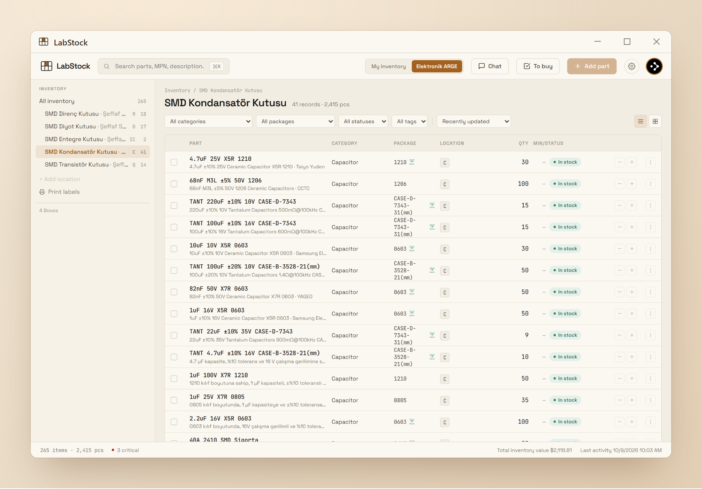
</p>

### Part details
MPN, manufacturer, parameters, movement history, location map, supplier info,
price and the projects a part is used in — on one page. Paste an LCSC code and
hit “Fetch” to fill in the manufacturer, description, category, parameters and
product photo automatically.

<p align="center">
  <picture>
    <source media="(prefers-color-scheme: dark)" srcset="docs/screenshots/parca-detay-koyu-en.png">
    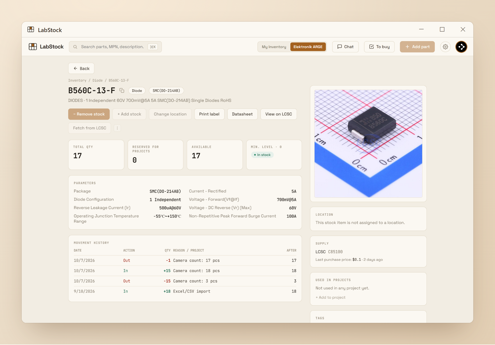
  </picture>
</p>

### Add parts from a link
Paste a product link into the “Add part” form and click **Fetch from link**: the
name, manufacturer, description, specifications, price and image are filled in
for you to review before saving. Direnç.net, Robotistan and Motorobit work out of
the box (free and fast). Add a free AI key in Settings (see
[Free AI providers](#free-ai-providers-and-daily-usage-bar) below) and it works on
**any shop's product page**. Keys are stored only in your own account and are never
shared; usage counts against your own free quota.

### Chat assistant
Open **Chat** from the top bar and ask about your inventory in plain language —
“Do I have something that steps 12 V down to 5 V?”. The assistant answers only
from your actual stock: it tells you where a part is and how many you have, or
suggests a functional alternative you do have. It replies in the language of the
interface.

<p align="center">
  <picture>
    <source media="(prefers-color-scheme: dark)" srcset="docs/screenshots/sohbet-asistani-koyu-en.png">
    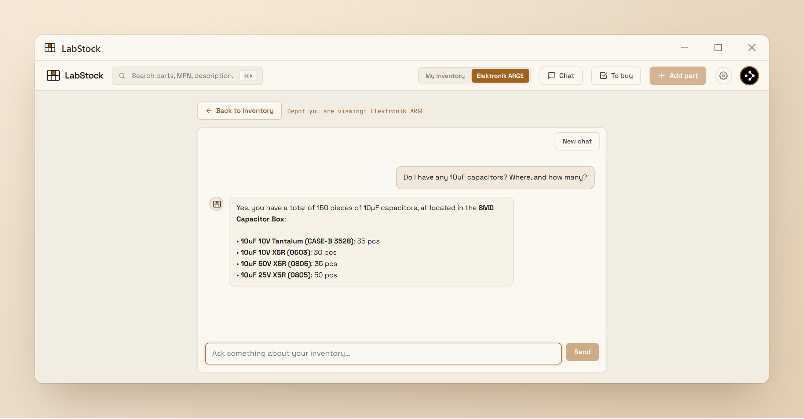
  </picture>
</p>

### Free AI providers and daily usage bar
The chat assistant, “Fetch from link” and LCSC description translation run on
your own AI keys — and you don't have to pay for them. Add keys from several free
providers in **Settings → AI API keys**; LabStock tries them in your order and
automatically moves on when one fails. A key whose daily free quota is used up is
skipped for the rest of the day, so nothing stops working.

| Provider | Free tier | Card needed |
|---|---|---|
| [Groq](https://console.groq.com/keys) | ≈1,000 requests/day, very fast | No |
| [Google Gemini](https://aistudio.google.com/apikey) | ≈250 requests/day | No |
| [OpenRouter](https://openrouter.ai/settings/keys) | 50 requests/day (1,000 after a one-time $10 top-up) | No |
| [Anthropic Claude](https://console.anthropic.com/settings/keys) | Paid (credits) — put it last as a fallback | Yes |

The **Today's free usage** bar adds up the daily quota of all your free keys and
shows how much is used, colored per provider, with a small bar and a
Ready / Quota used up status for each key. Limits are read from the provider's
responses where available.

### Printable QR labels
QR labels for every part and location, generated fully offline — print, cut,
stick them on the drawer. Scan one with a USB barcode reader (or paste it into the
search box) to jump straight to that part or location.

<p align="center">
  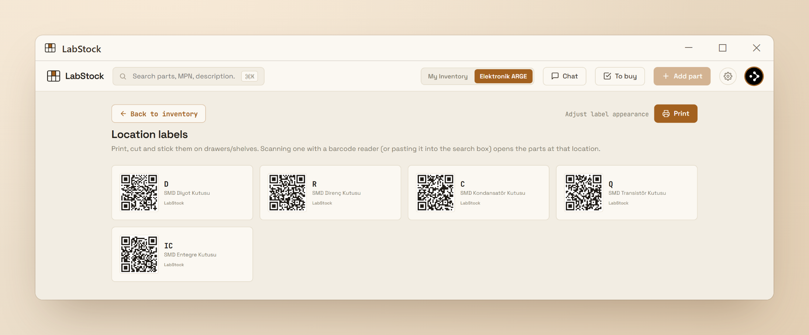
</p>

### Count parts with your phone camera (desktop app)

<p align="center">
  
</p>

Open **Phone camera** in the bottom-left corner and scan the QR code on screen
with your phone — no app to install; the phone's camera connects to LabStock over
your Wi-Fi. Show the part's or drawer's QR label (or search by name), pour the
parts onto the table, and the camera counts them; “Write to LabStock” sets the
quantity and records a “Count” in the movement history. Scan the QR on an LCSC bag
to add its quantity to stock (the same label is never counted twice); if the part
doesn't exist yet, a new part form pre-filled from LCSC opens. For more accurate
counts, put a coin next to the parts as a scale reference. All image processing
runs on your computer; the server only runs while you have it open, and devices
without the pairing key from the QR code can't connect.

**How it looks in practice**

1. **Pair** — open **Phone camera** in the bottom-left corner. The panel shows a
   QR code and three short steps; scan it with the phone's camera and confirm the
   one-time “connection is not private” prompt (the connection stays inside your
   own network). The status pill switches from *Phone waiting* to *Phone connected*
   and the live picture appears on the computer.

<p align="center">
  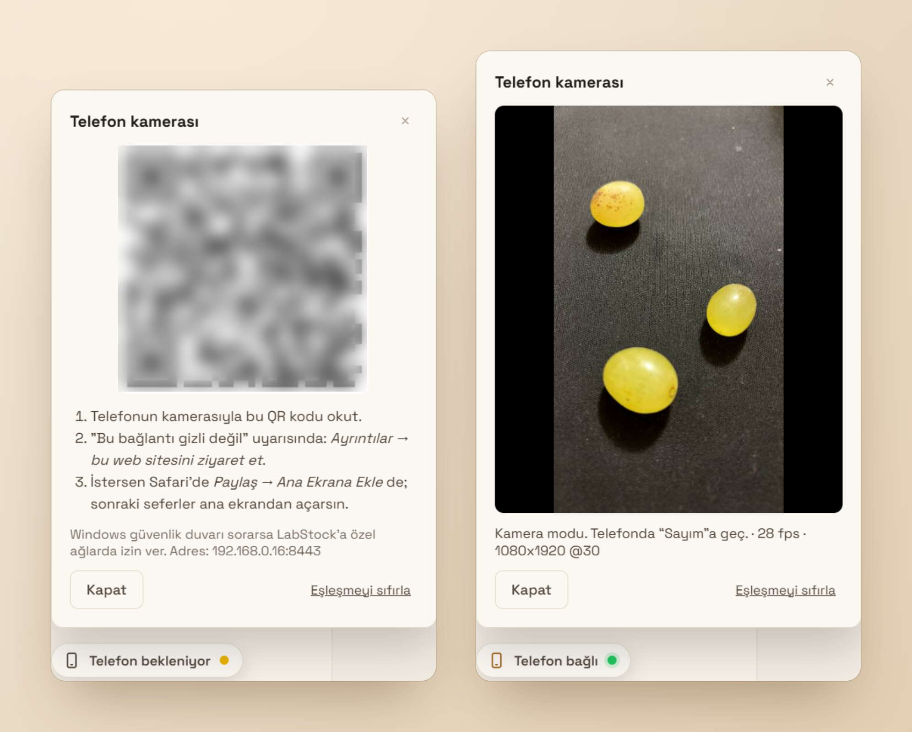
</p>

2. **Camera** — the phone streams 1080p H.264 video at 30 fps with ~10 ms latency;
   frame rate, bitrate and resolution are shown live.
3. **Count** — switch to *Count*: every object is boxed and counted on the
   computer (here: **3 pcs**). Show the part's QR label or search it by name, then
   write the count to LabStock with one tap.
4. **Settings** — choose the back or front camera, 720p / 1080p / 4K, H.264 video
   or JPEG frames and the bitrate; the panel also shows codec, frame size and
   dropped frames.

<p align="center">
  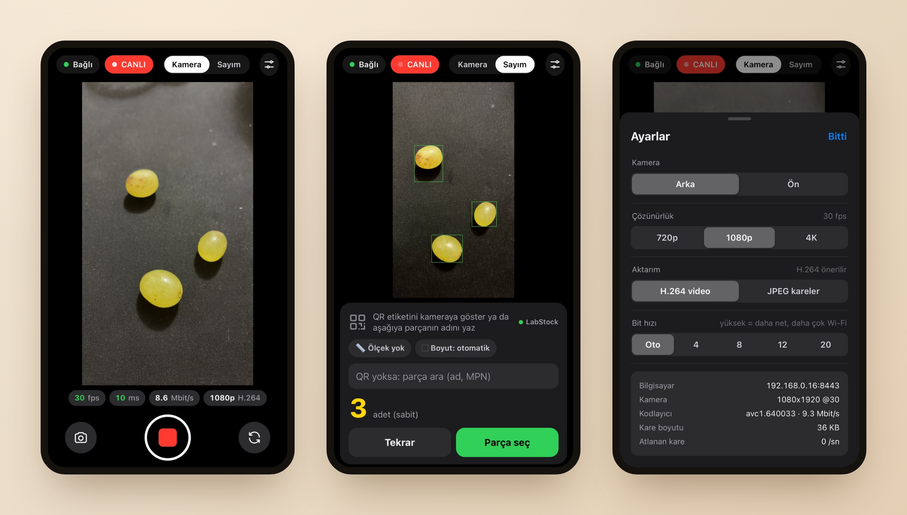
</p>

### Recent activity and shopping list
Every stock movement — camera counts, Excel imports, manual changes — on one
page. **To buy** is a simple shopping list with links, separate from the
inventory, so you don't forget what to order and where.

<p align="center">
  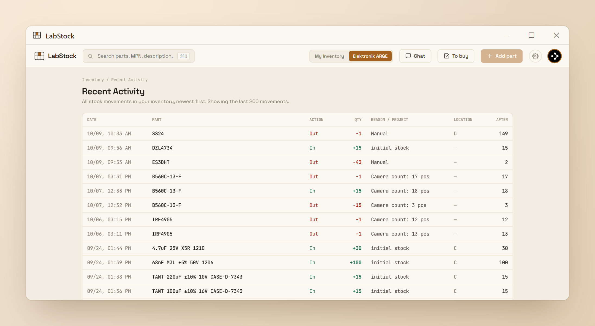
</p>
<p align="center">
  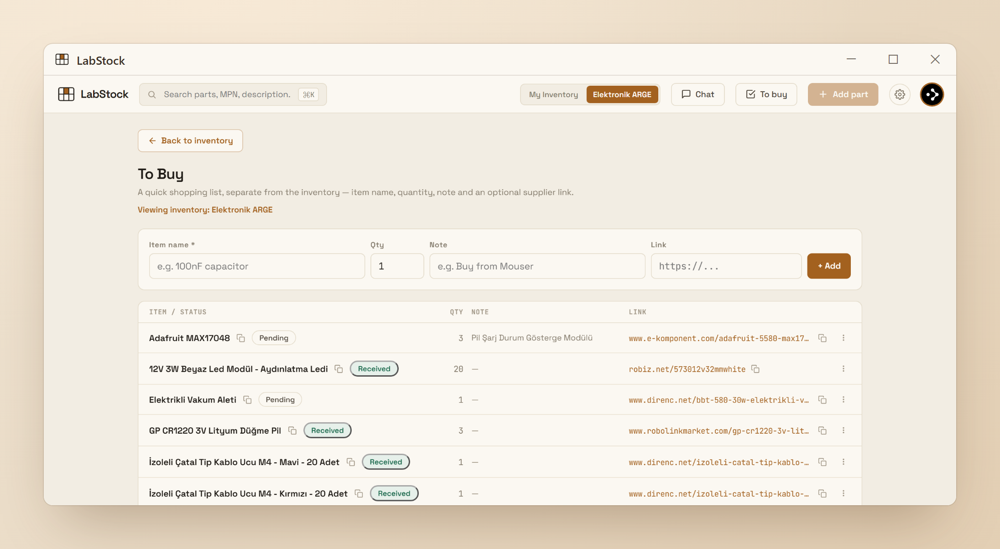
</p>

### Excel, viewers, weekly backup
- **Excel import/export:** import your existing inventory from a single
  `.xlsx`/`.csv` file (English or Turkish column headers); export everything to
  `.xlsx` at any time.
- **Viewers (read-only sharing):** generate an invite code in Settings to share
  your inventory read-only with a colleague or student; revoke access whenever
  you want.
- **Weekly summary + backup email:** every Monday you get critical stock, the
  total value and a CSV backup of the full list by email.

### Offline mode (your data stays on your computer)

By default your data is kept in a cloud database linked to your account (multiple
computers, viewers, weekly backup). In **Settings → Data storage** you can turn off
"Store in the cloud" to switch to **offline mode**: all data is kept only in an SQLite
file on this computer, is never sent to any server and works without internet. If you
don't want an account at all, use **"Use without an account"** on the sign-in screen.

- Switching from the cloud to offline copies all your account data to the computer.
- Going back to the cloud **adds** what you did offline on top of your cloud data —
  nothing is deleted; stock ins/outs on parts already in the cloud are applied as +/−.
- A backup of your cloud data is taken before every merge and can be added back from Settings.

### Desktop app and automatic updates
Installs on Windows with a setup wizard (no admin rights needed) and runs on Linux
as an AppImage or a .deb package. It checks for updates in the background on every launch. New versions are downloaded and
installed from a quiet in-app notification — no extra windows.

### Settings
Interface language (English / Türkçe), dark/light theme, label (QR) appearance,
AI keys with a daily usage bar (free Gemini, Groq and OpenRouter keys plus paid Claude — tried in order, a key whose free quota runs out is skipped), weekly backup email,
import/export, viewer management and in-app feedback.

<p align="center">
  <picture>
    <source media="(prefers-color-scheme: dark)" srcset="docs/screenshots/ayarlar-koyu-en.png">
    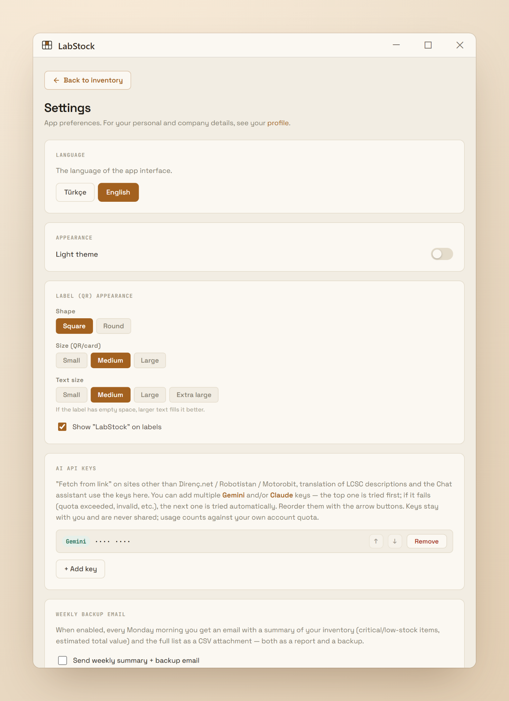
  </picture>
</p>

## Installation

> **Microsoft Store:** LabStock has been submitted to the Microsoft Store and is in
> certification. Once it is approved it will be available at
> [apps.microsoft.com/detail/9PH7DGF3HXL4](https://apps.microsoft.com/detail/9PH7DGF3HXL4)
> — signed by Microsoft, so there is no SmartScreen warning, and updated by the Store.

1. Download `LabStock-Kurulum.exe` from the
   [Releases](https://github.com/recepuysal/labstock/releases/latest) page.
2. Run it and follow the wizard (no admin rights needed; it installs into your
   user folder). Windows may show a SmartScreen warning because the installer
   isn't code-signed yet — click **More info → Run anyway**.
3. The app opens when installation finishes. Use “Create account” to set up your
   own inventory — you'll get a 6-digit verification code by email (valid for
   10 minutes).
4. To view someone else's inventory (read-only), enter the **invite code** they
   generated in their Settings into the “Invite code” field when signing up — or
   later from your Profile page.

The interface language follows your system language on first launch; change it
any time in **Settings → Language**.

### Linux

Two packages are on the [Releases](https://github.com/recepuysal/labstock/releases/latest) page
(x86_64):

- **AppImage** (any distribution):
  ```bash
  chmod +x LabStock-Linux-x86_64.AppImage
  ./LabStock-Linux-x86_64.AppImage
  ```
  Older distributions may need `libfuse2` (Ubuntu 24.04+: `sudo apt install libfuse2t64`).
  The AppImage updates itself.
- **.deb** (Ubuntu / Debian): `sudo apt install ./LabStock-Linux-amd64.deb` — it shows up in
  the application menu as LabStock. In-app updates install the new .deb and ask for your
  password.

Phone camera on Linux: if a firewall such as `ufw` is enabled, allow port 8443 on your
local network (`sudo ufw allow 8443/tcp`). Data is stored in `~/.config/labstock-desktop`.

## Feedback & contact

Found a bug, missing a feature? Two ways:

- In the app: **Settings → Feedback** — write and send.
- Email: **labstockassistant@gmail.com**

See the [privacy policy](PRIVACY.md) for what data the app handles.

## License

LabStock is free — install and use it for personal or commercial purposes. You
may not redistribute or publish the source code or a modified version; the only
official distribution channel is the
[Releases](https://github.com/recepuysal/labstock/releases) page of this
repository. See [LICENSE](LICENSE) for the full terms.

---

## Development

For contributors, or if you want to run the project against your own Supabase
project. The detailed (Turkish) version of this section is in
[README.tr.md](README.tr.md#geliştirme).

### 1. Supabase project

1. Create a new project on [supabase.com](https://supabase.com).
2. In the **SQL Editor**, run the files in `supabase/migrations/` in order
   (`0001_init.sql` sets up the schema, RLS policies, RPCs, the `envanter` view
   and the `handle_new_user()` trigger; the later files add AI keys and the
   weekly backup). Migrations are run by hand, not pushed by the CLI.
3. **Email verification (optional, recommended in production):** configure a
   custom SMTP provider under **Authentication → Emails → SMTP Settings**, enable
   **Confirm email**, and edit the **Confirm signup** template to show
   `{{ .Token }}` (the 6-digit code — the desktop app uses codes instead of links).
4. Copy the `Project URL` and `anon public` key from **Project Settings → API**.

### 2. Run the web app (for testing in a browser)

```bash
cp .env.example .env.local     # Windows: copy .env.example .env.local
# put your Supabase URL and anon key in .env.local

npm install
npm run dev
```

Open `http://localhost:3000` and create an account at `/kayit`.

### 3. Package the desktop app

```bash
npm run build:desktop          # Next.js standalone build, copied into electron-app/standalone
cd electron-app
npm ci                         # install exact dependencies (e.g. ws for the phone camera)
npx electron-builder --win     # produces electron-app/dist/LabStock-Kurulum.exe
npx electron-builder --win appx --publish never   # Microsoft Store package (LabStock-Store.appx)
```

`electron-app/main.js` starts the standalone server invisibly in the background
on launch and opens it in an Electron window when it's ready.

### 4. Publish a release

1. Bump `version` in `electron-app/package.json`.
2. `git commit`, then `git tag vX.Y.Z` and `git push origin master vX.Y.Z`.
3. `.github/workflows/build-desktop.yml` builds on GitHub's servers and attaches
   the `.exe` and `latest.yml` to a GitHub Release.
4. Installed apps pick it up on their next launch.

The Microsoft Store version is updated separately: build `LabStock-Store.appx`
from the same commit and create a new submission in Partner Center (see
[docs/microsoft-store.md](docs/microsoft-store.md)). Inside the Store build the
GitHub auto-updater is disabled (`process.windowsStore`).

`.github/workflows/keep-alive.yml` pings the Supabase project twice a week, so
free-plan projects aren't paused after 7 days of inactivity.

### Languages

The interface is available in Turkish and English. Strings live in
`src/lib/i18n/sozluk/*.ts` — each file exports a `tr` object and an `en` object of
the same shape (the TypeScript type enforces it). The language is stored in the
`labstock-dil` cookie; without it, the `Accept-Language` header decides. Server
components use `sozlukAl()` / `dilAl()` from `src/lib/i18n/sunucu.ts`; client
components use `useSozluk()` / `useDil()` from `src/lib/i18n/istemci.tsx`.
Category names are stored in Turkish and translated only for display
(`src/lib/i18n/kategori.ts`).

### AI providers

`src/lib/ai.ts` is the single entry point for every AI feature: it tries the
user's keys (`ai_anahtarlari`, ordered by `sira`) one by one, records each
attempt in `ai_kullanim` via the `ai_kullanim_kaydet` RPC, and moves keys that
hit their daily quota to the end of the list for the rest of the (UTC) day.
Gemini and Claude have their own clients (`src/lib/gemini.ts`, `src/lib/claude.ts`);
Groq and OpenRouter share an OpenAI-compatible client (`src/lib/openai-uyumlu.ts`).
Model names change often, so no model is hard-coded for those two: one is chosen
from the provider's `GET /models` list when the key is added (OpenRouter prefers
its `openrouter/free` router) and re-chosen if it disappears.

### Data model

The key design decision: **part definitions and stock are separate.**

| Table | Holds |
| --- | --- |
| `parts` | Shared catalog — MPN, manufacturer, category, package, datasheet, parameters. Not tied to a user. |
| `locations` | Each user's hierarchical location tree, with a `tip` (type) per node. |
| `stock_items` | A user's stock: part × location, quantity, min. level, supplier, purchase price. |
| `stock_movements` | Movement ledger — every +/- change, its reason and the resulting quantity. |
| `projects`, `project_bom` | Projects and bills of materials. |
| `tags`, `stock_item_tags` | Per-user free-form tags. |
| `profiles` | Name/company details, avatar, theme and viewer fields. |
| `feedback` | Messages from the in-app feedback form. |
| `alinacaklar` | The shopping list, separate from the inventory. |
| `ai_anahtarlari`, `ai_kullanim` | Each user's AI keys (provider, chosen model, daily limit) and per-key daily usage. |

Quantities are never written directly: the `stok_hareket()` RPC updates
`stock_items.adet` and records the movement together.
