<p align="center">
  
</p>

<p align="center"><a href="README.md">English</a> · <b>Türkçe</b></p>

<h3 align="center">“O direnç hangi çekmecedeydi?” sorusuna son.</h3>

<p align="center">
  Elektronik komponent deposu için ücretsiz stok takip uygulaması — parçaların
  hangi kutuda, kaç tane olduğunu bilir; QR etiket basar, LCSC'den ve ürün
  linkinden bilgiyi kendisi doldurur, deponla ilgili sorularını yapay zekâ ile cevaplar.
</p>

<p align="center">
  <a href="https://github.com/recepuysal/labstock/releases/latest"></a>
  <a href="https://github.com/recepuysal/labstock/releases"></a>
  
  
  
</p>

<p align="center">
  <a href="https://github.com/recepuysal/labstock/releases/latest/download/LabStock-Kurulum.exe">
    <strong>⬇ Windows için indir</strong>
  </a>
  ·
  <a href="#linux">⬇ Linux (AppImage / .deb)</a>
  ·
  <a href="#ekran-görüntüleri">Ekran görüntüleri</a>
  ·
  <a href="#geri-bildirim--iletişim">Geri bildirim</a>
</p>

<p align="center">
  <picture>
    <source media="(prefers-color-scheme: dark)" srcset="docs/screenshots/hero-koyu.png">
    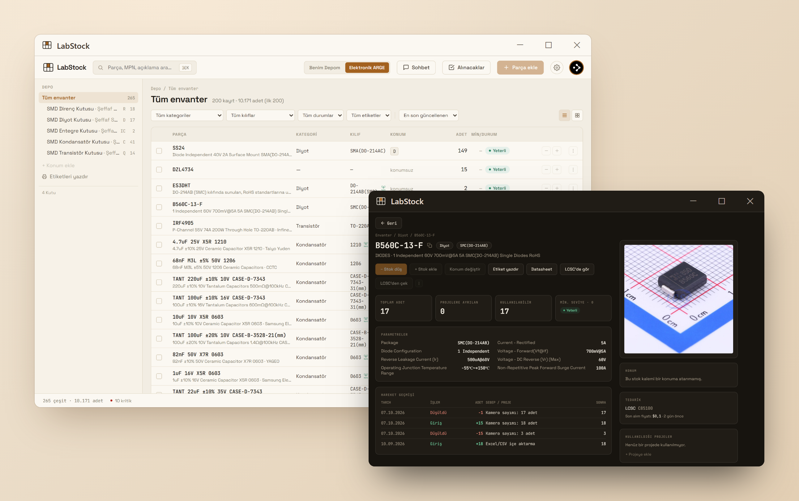
  </picture>
</p>

## Neden LabStock?

Elektronikle uğraşan ya da küçük bir üretim atölyesi işleten herkes aynı soruyu
sorar: *"O direnç hangi çekmecedeydi?"* LabStock parçalarını fiziksel
konumlarıyla (oda › dolap › çekmece › bölme) eşleştirir; arar, filtreler, QR
etiket basar, Excel'den toplu aktarır. Kurulumdan sonra her açılışta kendini
sessizce günceller, elle bir şey yapman gerekmez.

| | |
|---|---|
| 📦 **Konum ağacı** — oda › dolap › çekmece › bölme | 🔎 **Anında arama** — parça, MPN, açıklama |
| 🏷️ **QR etiketler** — yazdır, yapıştır, okut | ⚡ **LCSC'den ve linkten çek** — form kendiliğinden dolar |
| 💬 **Sohbet asistanı** — "elimde ne var?" diye sor | 📱 **Telefon kamerasıyla sayım** — uygulama kurmadan |
| 📊 **Excel içe/dışa aktarma** | 👥 **Gözlemci** — depoyu salt-okunur paylaş |
| 🌙 **Koyu / açık tema** | 🔄 **Sessiz otomatik güncelleme** |
| 🌍 **Türkçe ve İngilizce arayüz** | 🆓 **Ücretsiz** |
| 🤖 **Ücretsiz yapay zekâ + günlük kullanım barı** — Gemini, Groq, OpenRouter | 🛒 **Microsoft Store** — yakında (sertifikasyonda) |

## Ekran görüntüleri

Aşağıdaki görüntüler 265 çeşit / 10.000'den fazla komponent bulunan gerçek bir
ARGE deposundan alındı. GitHub'ı koyu temada kullanıyorsan görüntüler de koyu
temada görünür.

### Konum ağacı ve parça listesi
Oda › dolap › çekmece › bölme şeklinde hiyerarşik bir konum ağacı; parça
listesini konuma, kategoriye, kılıfa, duruma ve etikete göre filtrele, liste ya
da ızgara görünümünde incele. Alt çubukta toplam çeşit, adet, kritik stok ve
deponun tahmini değeri her zaman görünür.

<p align="center">
  <picture>
    <source media="(prefers-color-scheme: dark)" srcset="docs/screenshots/envanter-izgara-koyu.png">
    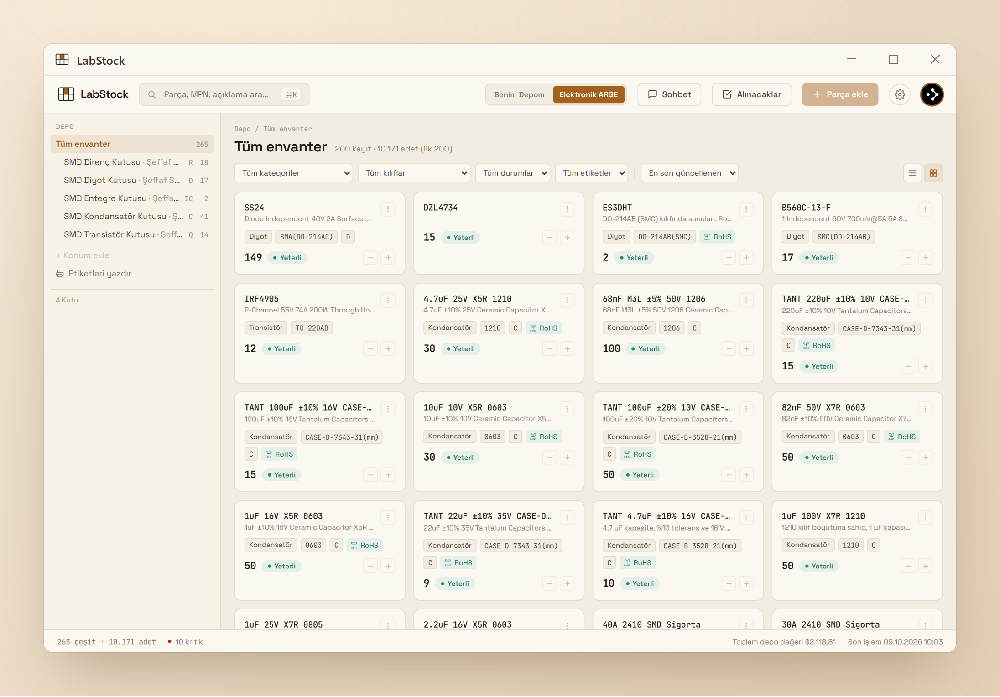
  </picture>
</p>

Bir kutuya tıklayınca sadece o kutudaki parçalar listelenir:

<p align="center">
  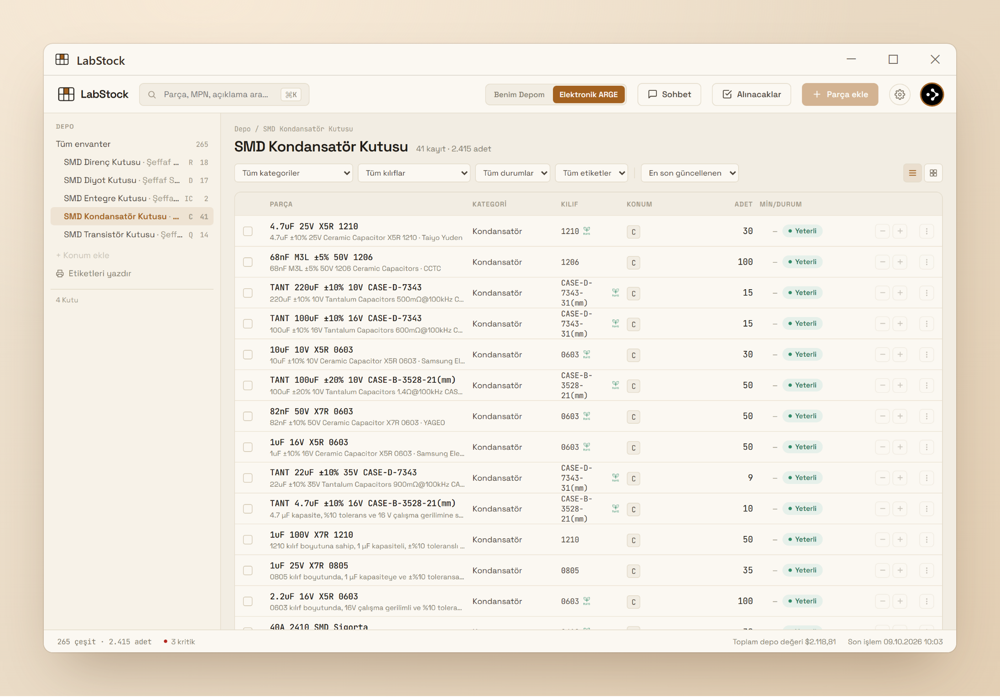
</p>

### Parça detayı
MPN, üretici, parametreler, hareket geçmişi, konum haritası, tedarik bilgisi,
fiyat ve hangi projelerde kullanıldığı — tek sayfada. LCSC kodunu yapıştırıp
"çek" dediğinde üretici, açıklama, kategori, parametreler ve ürün görseli
otomatik doldurulur; açıklama istersen Türkçeye çevrilir.

<p align="center">
  <picture>
    <source media="(prefers-color-scheme: dark)" srcset="docs/screenshots/parca-detay-koyu.png">
    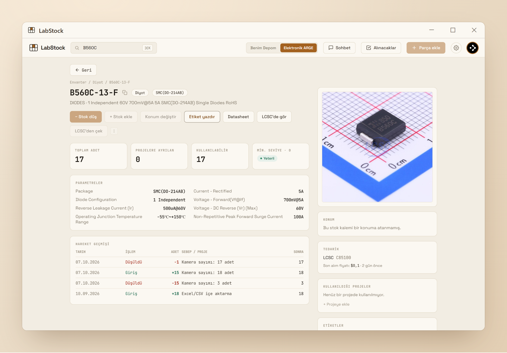
  </picture>
</p>

### Linkten otomatik malzeme ekleme
Malzeme ekleme formuna bir ürün linki yapıştırıp **Linkten çek** dediğinde
isim, üretici, açıklama, teknik özellikler, fiyat ve görsel otomatik dolar —
kaydetmeden önce gözden geçirip düzeltebilirsin. Direnç.net, Robotistan ve
Motorobit için yerleşik (ücretsiz, hızlı) destek var; Ayarlar'dan ücretsiz
bir yapay zekâ anahtarı eklersen (aşağıda [Ücretsiz yapay zekâ](#ücretsiz-yapay-zekâ-sağlayıcıları-ve-günlük-kullanım-barı))
**herhangi bir satıcı sitesinde** de çalışır. Anahtarlar sadece kendi hesabında
saklanır, kimseyle paylaşılmaz; kullanım kendi ücretsiz kotandan düşer.

<p align="center">
  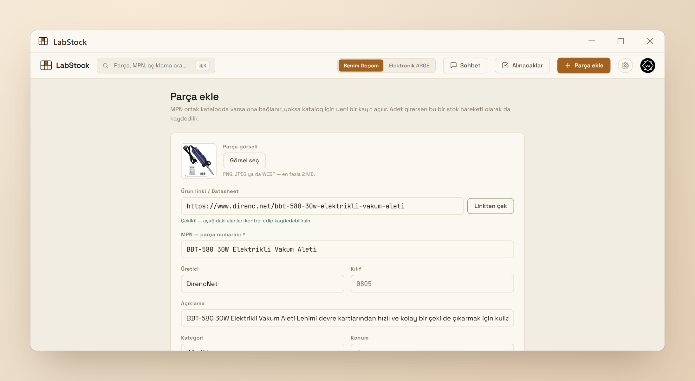
</p>

### Sohbet asistanı
Üst bardaki **Sohbet**'ten deponla ilgili doğal dilde soru sor — "12V'u 5V'a
düşüren bir şeyim var mı?" gibi. Asistan sadece senin gerçek envanterine bakarak
cevap verir: bir şey varsa nerede ve kaç tane olduğunu söyler, yoksa stoktaki
işlevsel bir alternatifi önerir. Konuşma bu bilgisayarda saklanır; "Yeni sohbet"
ile temizlenir.

<p align="center">
  <picture>
    <source media="(prefers-color-scheme: dark)" srcset="docs/screenshots/sohbet-asistani-koyu.png">
    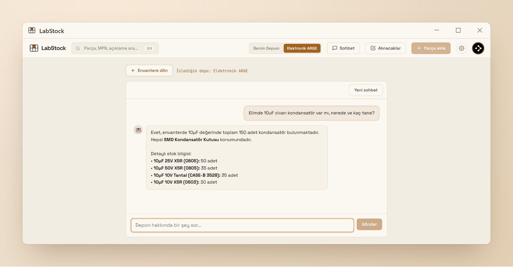
  </picture>
</p>

### Ücretsiz yapay zekâ sağlayıcıları ve günlük kullanım barı
Sohbet asistanı, "Linkten çek" ve LCSC açıklama çevirisi senin kendi yapay zekâ
anahtarlarınla çalışır — ve bunlar için para ödemen gerekmez. **Ayarlar → Yapay
zekâ API anahtarları**'ndan birden fazla ücretsiz sağlayıcının anahtarını ekle;
LabStock onları senin sıranla dener, biri çalışmazsa otomatik olarak sıradakine
geçer. Günlük ücretsiz kotası dolan anahtar o gün boyunca atlanır, hiçbir şey
yarıda kalmaz.

| Sağlayıcı | Ücretsiz kota | Kart gerekir mi? |
|---|---|---|
| [Groq](https://console.groq.com/keys) | Günde ≈1.000 istek, çok hızlı | Hayır |
| [Google Gemini](https://aistudio.google.com/apikey) | Günde ≈250 istek | Hayır |
| [OpenRouter](https://openrouter.ai/settings/keys) | Günde 50 istek (bir kez 10 $ yüklenirse 1.000) | Hayır |
| [Anthropic Claude](https://console.anthropic.com/settings/keys) | Ücretli (kredi) — yedek olarak en alta koy | Evet |

**Bugünkü ücretsiz kullanım** barı tüm ücretsiz anahtarlarının günlük kotasını
toplar; ne kadarının kullanıldığını sağlayıcı renkleriyle, her anahtar için de
küçük bir bar ve Hazır / Kota doldu durumuyla gösterir. Limitler mümkünse
sağlayıcının kendi yanıtlarından okunur.

<p align="center">
  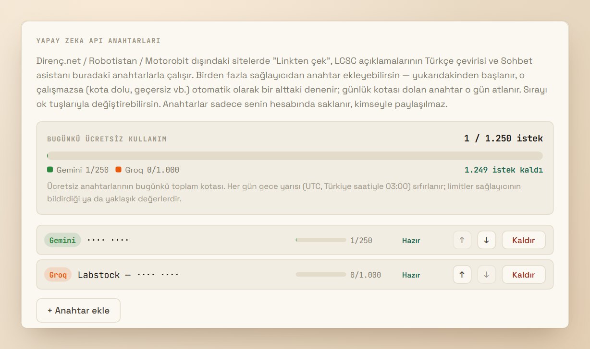
</p>

### Yazdırılabilir QR etiketler
Her parça ve konum için tamamen çevrimdışı üretilen QR etiketler — yazdır, kes,
çekmeceye yapıştır. USB barkod okuyucuyla (ya da arama kutusuna yapıştırarak)
okutunca doğrudan ilgili parçaya/konuma atlar.

<p align="center">
  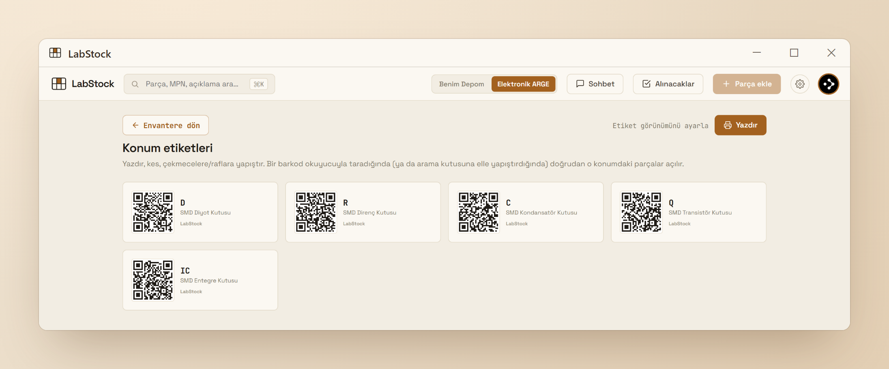
</p>

### Telefon kamerasıyla sayım ve etiketten giriş (masaüstü uygulaması)

<p align="center">
  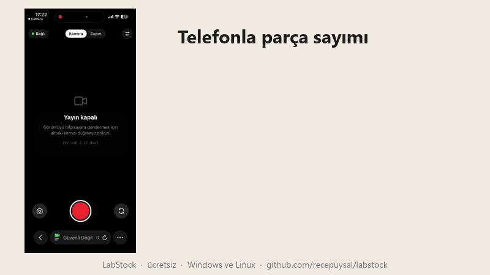
</p>

Sol alttaki **Telefon kamerası**'nı açıp ekrandaki QR'ı telefonla okut —
uygulama kurmadan, aynı Wi-Fi üzerinden telefonun kamerası LabStock'a bağlanır.
Parçanın ya da çekmecenin QR etiketini göster (etiket yoksa adıyla ara),
parçaları masaya dök: kamera sayar, "LabStock'a yaz" deyince adet sayılan değere
ayarlanır ve hareket geçmişine "Sayım" olarak düşer. LCSC poşetinin QR'ını
okutunca adet stoğa eklenir (aynı etiket iki kez işlenmez); parça yoksa LCSC'den
doldurulmuş yeni parça formu açılır. Daha doğru sayım için yanına bir madeni para
koyup ölçek al. Görüntü işleme tamamen bilgisayarında yapılır; sunucu sadece sen
açınca çalışır ve QR'daki eşleşme anahtarı olmayan cihaz bağlanamaz.

**Pratikte nasıl görünüyor**

1. **Eşleştir** — sol alttaki **Telefon kamerası**'nı aç. Panelde bir QR kod ve üç
   kısa adım çıkar; telefonun kamerasıyla okut ve bir kereye mahsus "bağlantı gizli
   değil" uyarısını onayla (bağlantı kendi ağının içinde kalır). Durum düğmesi
   *Telefon bekleniyor*'dan *Telefon bağlı*'ya döner, canlı görüntü bilgisayarda belirir.

<p align="center">
  
</p>

2. **Kamera** — telefon 30 fps'de, yaklaşık 10 ms gecikmeyle 1080p H.264 video
   gönderir; kare hızı, bit hızı ve çözünürlük canlı olarak görünür.
3. **Sayım** — *Sayım*'a geç: her nesne kutu içine alınıp bilgisayarda sayılır
   (burada: **3 adet**). Parçanın QR etiketini göster ya da adıyla ara, sonra sayıyı
   tek dokunuşla LabStock'a yaz.
4. **Ayarlar** — arka/ön kamera, 720p / 1080p / 4K, H.264 video ya da JPEG kareler
   ve bit hızı seçilir; panel kodlayıcıyı, kare boyutunu ve atlanan kareleri de gösterir.

<p align="center">
  
</p>

### Son aktiviteler ve alınacaklar
Depodaki her stok hareketi — kamera sayımları, Excel aktarımları, elle girişler —
tek sayfada. **Alınacaklar** ise envanterden bağımsız, linkli bir alışveriş
listesi: neyi nereden alacağını unutma.

<p align="center">
  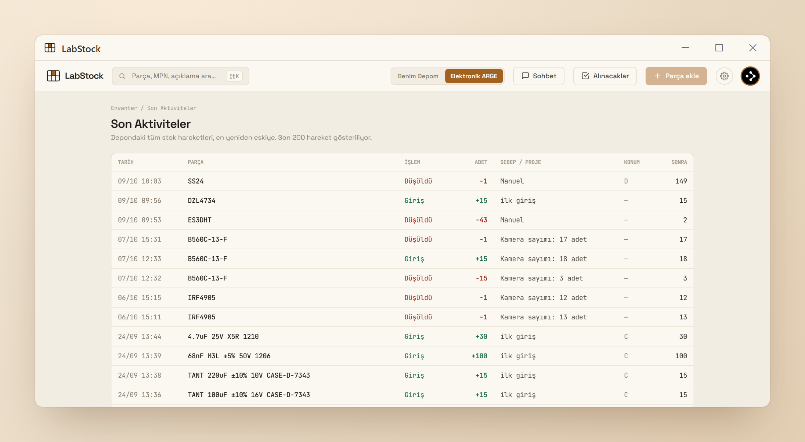
</p>
<p align="center">
  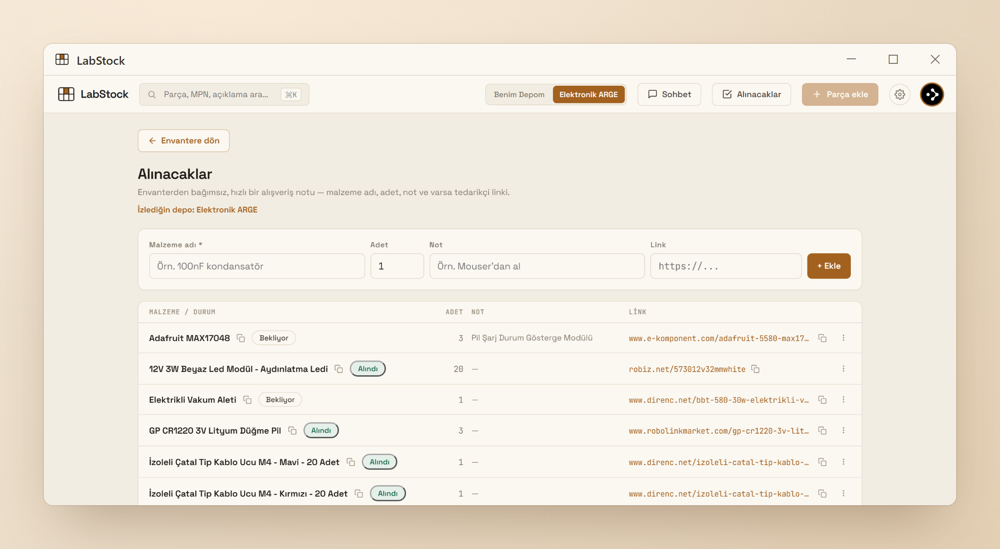
</p>

### Excel, gözlemci, haftalık yedek
- **Excel ile toplu aktarım:** elindeki envanteri tek bir `.xlsx`/`.csv` ile içe
  aktar; tüm depoyu istediğin an `.xlsx` olarak dışa aktar.
- **Gözlemci (salt-okunur paylaşım):** Ayarlar'dan ürettiğin davet koduyla deponu
  bir meslektaşınla ya da öğrencinle salt-okunur paylaş; erişimi istediğin an kaldır.
- **Haftalık özet + yedek e-postası:** her Pazartesi kritik stoklar, toplam değer
  ve tam listenin CSV yedeği e-postana gelir.

### Çevrimdışı mod (verilerin sadece bilgisayarında)

Varsayılan olarak veriler hesabına bağlı bir bulut veritabanında tutulur (birden
fazla bilgisayar, gözlemci, haftalık yedek). İstersen **Ayarlar → Veri depolama**'dan
"Bulutta sakla"yı kapatıp **çevrimdışı moda** geçebilirsin: tüm veriler yalnızca bu
bilgisayardaki bir SQLite dosyasında tutulur, hiçbir sunucuya gönderilmez ve
internetsiz çalışır. Hesap açmak istemiyorsan giriş ekranındaki **"Hesapsız kullan"**
ile de doğrudan başlayabilirsin.

- Buluttan çevrimdışına geçerken hesabındaki tüm veriler bilgisayara kopyalanır.
- Buluta dönerken çevrimdışıyken yaptıkların **buluttakilerin üstüne eklenir** —
  hiçbir şey silinmez; bulutta olan parçalardaki giriş/çıkışlar +/− olarak işlenir.
- Her eklemeden önce buluttaki verilerin yedeği alınır ve Ayarlar'dan geri eklenebilir.

### Masaüstü uygulaması ve otomatik güncelleme
Windows'a kurulum sihirbazıyla kurulur (yönetici izni gerekmez), Linux'ta AppImage
ya da .deb paketiyle çalışır. Her açılışta arka planda güncelleme kontrolü yapar; yeni sürüm varsa uygulama içi sessiz bir
bildirimle indirilip kurulur — hiçbir pencere açılmaz.

<p align="center">
  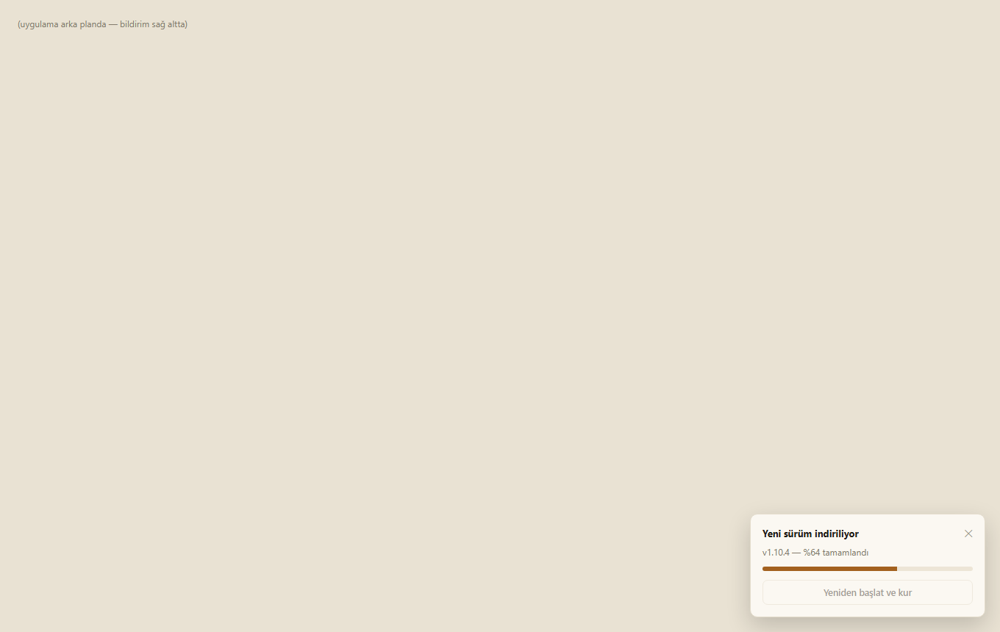
</p>

### Ayarlar
Arayüz dili (Türkçe / English), koyu/açık tema, etiket (QR) görünümü, günlük kullanım barıyla yapay zekâ
anahtarları (ücretsiz Gemini, Groq ve OpenRouter ile ücretli Claude — sırayla
denenir, ücretsiz kotası dolan anahtar atlanır), haftalık yedek e-postası, içe/dışa
aktarma, gözlemci yönetimi ve uygulama içinden geri bildirim.

<p align="center">
  <picture>
    <source media="(prefers-color-scheme: dark)" srcset="docs/screenshots/ayarlar-koyu.png">
    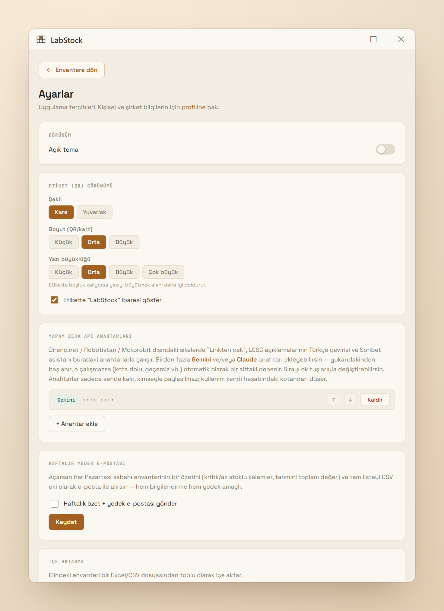
  </picture>
</p>

## Kurulum (kullanıcı olarak)

> **Microsoft Store:** LabStock Microsoft Store'a gönderildi ve sertifikasyonda.
> Onaylanınca [apps.microsoft.com/detail/9PH7DGF3HXL4](https://apps.microsoft.com/detail/9PH7DGF3HXL4)
> adresinden kurulabilecek — Microsoft tarafından imzalı (SmartScreen uyarısı yok) ve
> güncellemeleri Store yapar.

1. [Releases](https://github.com/recepuysal/labstock/releases/latest) sayfasından
   `LabStock-Kurulum.exe` dosyasını indir.
2. Çalıştır, sihirbazı takip et (yönetici izni gerekmez, kendi kullanıcı klasörüne kurulur).
   Kurulum dosyası henüz dijital olarak imzalanmadığı için Windows bir SmartScreen
   uyarısı gösterebilir — **Ek bilgi → Yine de çalıştır** de.
3. Kurulum bitince uygulama açılır. "Hesap oluştur" ile kendi deponu kurarsın —
   kayıt olunca e-postana 6 haneli bir doğrulama kodu gelir (10 dakika geçerli),
   kodu girip onaylayınca depon hazır olur.
4. Başka birinin deposunu (salt-okunur) izlemek istiyorsan, o kişinin Ayarlar
   sayfasından ürettiği **davet kodunu** kayıt ekranındaki "Davet kodu" alanına
   gir — ya da kayıt olduktan sonra Profil sayfasından da girebilirsin.

Arayüz dili ilk açılışta sistem diline göre seçilir; istediğin an
**Ayarlar → Dil**'den değiştirebilirsin.

### Linux

[Releases](https://github.com/recepuysal/labstock/releases/latest) sayfasında iki paket var
(x86_64):

- **AppImage** (her dağıtımda çalışır):
  ```bash
  chmod +x LabStock-Linux-x86_64.AppImage
  ./LabStock-Linux-x86_64.AppImage
  ```
  Bazı dağıtımlarda `libfuse2` gerekebilir (Ubuntu 24.04+: `sudo apt install libfuse2t64`).
  AppImage kendini günceller.
- **.deb** (Ubuntu / Debian): `sudo apt install ./LabStock-Linux-amd64.deb` — uygulama
  menüsünde LabStock olarak görünür. Uygulama içi güncelleme yeni .deb'i kurar ve şifreni sorar.

Linux'ta telefon kamerası: `ufw` gibi bir güvenlik duvarı açıksa yerel ağda 8443 portuna izin
ver (`sudo ufw allow 8443/tcp`). Veriler `~/.config/labstock-desktop` klasöründe durur.

Uygulama her açılışta arka planda güncelleme kontrolü yapar. Yeni bir sürüm
varsa sağ altta uygulama içi bir bildirim çıkar (Windows penceresi değil) —
"İndir" dedikten sonra ilerleme çubuğunu görürsün, "Yeniden başlat ve kur"
dediğinde de hiçbir pencere açılmadan sessizce güncellenip kendini yeniden açar.

## Geri bildirim & iletişim

Bir hata mı buldun, bir özellik mi eksik? İki yolu var:

- Uygulama içinden: **Ayarlar → Geri Bildirim** kartından doğrudan yaz, gönder.
- E-posta: **labstockassistant@gmail.com**

Uygulamanın hangi verileri işlediği için [gizlilik politikasına](PRIVACY.md#gizlilik-politikası--labstock) bak.

## Lisans

LabStock ücretsizdir — kişisel ya da ticari amaçla kurup kullanabilirsin. Kaynak
kodu ya da değiştirilmiş bir sürümünü başkalarına dağıtamaz/yayınlayamazsın;
tek resmî dağıtım kanalı bu depodaki [Releases](https://github.com/recepuysal/labstock/releases)
sayfasıdır. Tam şartlar için [LICENSE](LICENSE) dosyasına bak.

---

## Geliştirme

Aşağısı katkıda bulunmak ya da projeyi kendi Supabase projenle çalıştırmak
isteyenler için.

### 1. Supabase projesi

1. [supabase.com](https://supabase.com) üzerinde yeni bir proje aç.
2. **SQL Editor**'ü aç, `supabase/migrations/0001_init.sql` dosyasının tamamını
   yapıştır ve çalıştır. (Şema, RLS politikaları, `stok_hareket()`/gözlemci
   RPC'leri, `envanter` view'ı ve `handle_new_user()` tetikleyicisi bir kerede kurulur.)
   Ardından kalan dosyaları sırayla aynı şekilde çalıştır: `0002`–`0003` (yapay zekâ
   anahtarları), `0004` (haftalık yedek e-postası), `0005`–`0006` (ücretsiz yapay zekâ
   sağlayıcıları ve günlük kullanım sayacı). (Bu proje migration'ları CLI ile otomatik
   push etmiyor, hepsi elle SQL Editor'de çalıştırılır.)
3. **Authentication → Sign In / Providers → Email**: geliştirme sırasında
   "Confirm email" kapalıysa (varsayılan) kayıt olur olmaz giriş yapabilirsin —
   e-posta doğrulama akışını denemek istersen adım 4'e bak.
4. **E-posta doğrulama (isteğe bağlı, üretimde önerilir)**: Supabase'in kendi
   mailer'ı saatte birkaç e-postayla sınırlı olduğundan gerçek kullanım için
   özel bir SMTP sağlayıcısı (ör. bir Gmail hesabının "Uygulama Şifresi" ile
   `smtp.gmail.com`, ya da Resend/SendGrid gibi bir servis — bunlar kendi alan
   adını doğrulamanı ister) gerekir:
   - **Authentication → Emails → SMTP Settings**'ten kendi bilgilerini gir.
   - **Authentication → Sign In / Providers → Email → Confirm email**'i aç.
   - **Authentication → Emails → Confirm signup** şablonunu `{{ .Token }}`
     değişkenini (6 haneli kod) gösterecek şekilde düzenle — link değil kod
     kullanıyoruz, çünkü masaüstü uygulamasında e-postadaki linke tıklamak
     harici bir tarayıcı açar ve oradan uygulamaya geri bildirim almak
     (custom protocol handler) gereksiz karmaşıklık yaratır.
   - Bu ayarlar `supabase/migrations/0001_init.sql` dosyasının dışında —
     proje bazlı, dashboard'dan (ya da Management API'den) yapılır.
5. **Project Settings → API** ekranından `Project URL` ve `anon public` anahtarını al.

### 2. Web tarafında çalıştırmak (tarayıcıda test için)

```bash
cp .env.example .env.local     # Windows: copy .env.example .env.local
# .env.local içine Supabase URL ve anon key'i yaz

npm install
npm run dev
```

`http://localhost:3000` → `/kayit` ile hesap aç.

### 3. Masaüstü uygulaması olarak paketlemek

```bash
npm run build:desktop          # Next.js'i derler ve electron-app/standalone'a kopyalar
cd electron-app
npm ci                         # bağımlılıkları eksiksiz kur (ör. telefon kamerası için ws)
npx electron-builder --win     # electron-app/dist/LabStock-Kurulum.exe üretir
npx electron-builder --win appx --publish never   # Microsoft Store paketi (LabStock-Store.appx)
```

`electron-app/main.js` uygulama açılışında bu standalone sunucuyu arka planda
(görünmez) başlatır, hazır olduğunda bir Electron penceresinde açar.

### 4. Yeni bir sürüm yayınlamak

1. `electron-app/package.json`'daki `version`'ı artır (ör. `1.6.0` → `1.6.1`).
2. `git commit`, sonra `git tag v1.6.1` ve `git push origin master v1.6.1`.
3. `.github/workflows/build-desktop.yml` GitHub'ın kendi sunucusunda otomatik
   derler ve `.exe` + `latest.yml`'i bir GitHub Release'e ekler.
4. Kurulu olan uygulamalar bir sonraki açılışlarında bunu fark edip güncellenir.

Microsoft Store sürümü ayrıca güncellenir: aynı commit'ten `LabStock-Store.appx`
üretilip Partner Center'da yeni bir gönderim yapılır (bkz.
[docs/microsoft-store.md](docs/microsoft-store.md)). Store sürümünde GitHub'dan
otomatik güncelleme kapalıdır (`process.windowsStore`).

`.github/workflows/keep-alive.yml` ayrıca haftada iki kez Supabase projesine
hafif bir istek atar — ücretsiz plandaki projeler 7 gün hiç istek almazsa
otomatik duraklatıldığı için bunu önler.

### 5. Geri bildirim maili (isteğe bağlı)

Ayarlar sayfasındaki geri bildirim formu her zaman `feedback` tablosuna yazar;
ayrıca her yeni kayıtta güzel bir HTML mail gitmesini istersen ([Resend](https://resend.com)
ücretsiz planıyla):

1. [resend.com](https://resend.com)'da ücretsiz bir hesap aç, bir **API key**
   üret (`re_...` ile başlar). Alan adı doğrulamadan (`onboarding@resend.dev` ile)
   Resend sadece **hesabı açan kişinin kendi adresine** gönderime izin veriyor —
   şu an tetikleyici bu yüzden `labstockassistant@gmail.com` yerine hesabı açan
   `rcpuysl@icloud.com`'u hedefliyor (`supabase/migrations/0001_init.sql`'deki
   `feedback_bildir()` fonksiyonundan değiştirilebilir). 3bfab.com resend.com/domains'te
   doğrulanırsa istenen herhangi bir adrese gönderilebilir.
2. `supabase/migrations/0001_init.sql`'in tamamını SQL Editor'de çalıştır —
   `pg_net` tetikleyicisini ve anahtarı tutacak `private.ayarlar` tablosunu
   kurar (bu şema PostgREST'e hiç açılmaz, sadece sunucu tarafı fonksiyonlar okur).
3. Anahtarı SQL Editor'de ayrı bir sorgu olarak ekle (bu komut `0001_init.sql`'in
   dışında — git'e komit edilmesin diye):
   ```sql
   insert into private.ayarlar (anahtar, deger) values ('resend_api_key', 're_senin_anahtarin')
   on conflict (anahtar) do update set deger = excluded.deger;
   ```
   (`alter database ... set` ile bir GUC ayarlamayı denedik ama Supabase'in
   yönetilen Postgres'i buna superuser istiyor — tablo tabanlı bu yöntem
   herhangi bir ek yetki gerektirmiyor.)

Anahtar ayarlanmamışsa tetikleyici sessizce hiçbir şey yapmaz; form yine de
normal çalışır, sadece mail gitmez.

## Veri modeli

Kritik tasarım kararı: **parça tanımı ile stok ayrı**.

| Tablo | Ne tutar |
| --- | --- |
| `parts` | Ortak katalog — MPN, üretici, kategori, kılıf, datasheet, parametreler. Kullanıcıdan bağımsız; herkes ekledikçe büyür. |
| `locations` | Kullanıcıya ait hiyerarşik konum ağacı (oda › dolap › çekmece › bölme), her düğümde bir `tip`. |
| `stock_items` | Kullanıcının elindeki stok: parça × konum, adet, min. seviye, tedarikçi, alış fiyatı. |
| `stock_movements` | Hareket defteri — her +/- işlem, sebebi ve sonraki adet. |
| `projects`, `project_bom` | Proje ve malzeme listesi. Parça detay sayfasından ekleniyor; ayrı bir Projeler sayfası henüz yok. |
| `tags`, `stock_item_tags` | Kullanıcıya özel serbest etiketler; bir stok kalemine birden fazla etiket iliştirilebilir. |
| `profiles` | Ad/telefon/şirket bilgisi, profil fotoğrafı, tema tercihi ve gözlemcilik alanları (`davet_kodu`, `gozlemci_of`, `gozlemci_baglandi`, `son_gorulme`). |
| `feedback` | Ayarlar sayfasındaki geri bildirim formundan gelen mesajlar. |
| `alinacaklar` | Envanterden bağımsız, hızlı bir alışveriş notu listesi (malzeme adı, adet, not, link). |
| `ai_anahtarlari`, `ai_kullanim` | Kullanıcının yapay zekâ anahtarları (sağlayıcı, seçilen model, günlük limit) ve anahtar başına günlük kullanım. |

Adet doğrudan yazılmaz: `stok_hareket()` RPC'si `stock_items.adet` güncellemesi ile
hareket kaydını birlikte yapar.

### Çok kullanıcılı izolasyon

Her kullanıcı tablosunda `user_id = auth.uid()` RLS politikası var; izolasyon
uygulama katmanında değil **veritabanı seviyesinde**. `envanter` view'ı
`security_invoker = true` ile tanımlı, yani view bir yetki kaçağı oluşturmaz.
`parts` ortak katalog olduğu için herkes okur; sadece ekleyen düzenler.

### Gözlemci (salt-okunur izleyici) rolü

Bir hesap, Ayarlar sayfasından ürettiği **davet kodunu** paylaşarak başkalarının
kendi deposunu salt-okunur izlemesine izin verebilir:

- Davet kodu girildiğinde `gozlemci_baglan()` RPC'si (ya da kayıt sırasında
  `handle_new_user()` tetikleyicisi) `profiles.gozlemci_of` alanını sahibin
  `user_id`'sine bağlar. Bir sahibin izleyen sayısı **8 ile sınırlı**.
- Her tabloya, mevcut "kendi verin" RLS politikasına dokunmadan ek bir
  **salt-okunur SELECT** politikası eklenmiş durumda (`*_gozlemci_read`) —
  Postgres'te aynı komut için birden fazla politika OR'lanır.
- Bir gözlemci kendi deposunu da kullanabilir: hangi deponun aktif olduğu
  (`aktifGorunumAl()`, `src/lib/gozlemci.ts`) bir cookie ile tutulur, tüm
  sorgular buna göre açıkça filtrelenir — RLS'e tek başına güvenmek, sahiplik
  ve izleme politikaları aynı anda aktifken iki deponun karışmasına yol açar.
- Üst bardaki geçiş kontrolü ile "Benim deposu" / "İzlediğim depo" arasında
  değişilir; izleme modunda tüm düzenleme/silme arayüzü gizlenir.

## Şu an ne var

- E-posta + şifre ile kayıt/giriş, "beni hatırla", 6 haneli kodla e-posta doğrulama
- Konum ağacı: alt ağaca göre filtreleme, adet rozetleri, aç/kapa, bölme haritası, düzenle/sil
- Parça listesi: arama, kategori/kılıf/durum/etiket filtreleri, sıralama, liste/ızgara görünümü
- Parça detay sayfası: parametreler, hareket geçmişi, konum haritası, tedarik bilgisi,
  kullanıldığı projeler, serbest etiketler, RoHS rozeti, parça görseli
- Linkten otomatik malzeme ekleme: Direnç.net/Robotistan/Motorobit için yerleşik
  destek, Ayarlar'dan eklenen ücretsiz bir yapay zekâ anahtarıyla herhangi bir
  satıcı sitesi
- Sohbet asistanı: gerçek envanterine dayanarak doğal dilde soru cevaplar,
  yoksa alternatif önerir
- Yapay zekâ anahtarları: ücretsiz Gemini, Groq, OpenRouter ve ücretli Claude; sırayla
  denenir, kotası dolan atlanır; Ayarlar'da günlük ücretsiz kullanım barı
- Türkçe ve İngilizce arayüz (Ayarlar → Dil; ilk açılışta Windows diline göre)
- Yazdırılabilir QR etiketler (tek parça + toplu konum), USB barkod okuyucu desteği
- Excel/CSV toplu içe aktarma; Ayarlar'dan tüm envanteri `.xlsx` olarak dışa aktarma
- Son Aktiviteler: depodaki tüm stok hareketlerinin tek sayfada listesi
- Alınacaklar: üst bardan hızlı erişilen, envanterden bağımsız basit bir alışveriş
  notu listesi (malzeme adı, adet, not, link)
- Ayarlar: koyu/açık tema, etiket (QR) görünüm ayarları, sürüm bilgisi ve güncelleme
  kontrolü, gözlemci davet kodu yönetimi, uygulama içi geri bildirim formu
- Profil: kişisel/şirket bilgileri, profil fotoğrafı/şirket logosu yükleme, gözlemcilik bağlantısı
- Gözlemci rolü: davet koduyla salt-okunur depo paylaşımı, sahip tarafından tek taraflı çıkarma
- Microsoft Store paketi (MSIX); Store'a gönderildi, sertifikasyonda
- Windows masaüstü uygulaması: Electron ile paketleme, GitHub Releases üzerinden
  sessiz otomatik güncelleme, Supabase projesini uyanık tutan zamanlanmış ping

## Sırada

- Çoklu tedarikçi fiyat karşılaştırması (`part_suppliers` şeması hazır, arayüzü yok)
- Ayrı bir Projeler sayfası: bir projeyi üretmek için eksik parça hesaplama
- Sistem tepsisi simgesi, Windows açılışında otomatik başlatma
- Düşük stok için bildirim

## Notlar

- Fontlar `<link>` ile Google Fonts'tan geliyor (`src/app/layout.tsx`). Ağı kısıtlı
  bir ortamda build alacaksan `next/font` yerine bu yöntem kırılmaz.
- Arayüz teması `src/app/globals.css` içindeki CSS değişkenlerinde: PCB fiberglas
  krem zemin, bakır `#A3611F` aksan, Space Grotesk + JetBrains Mono; koyu tema
  `[data-theme='koyu']` altında ayrı bir token seti olarak tanımlı.
- `labstock-a1-logo/` klasöründe logo setinin kaynak SVG/PNG'leri ve kullanım
  kuralları (`LOGO.md`) var; doğrulama e-postasındaki logo da buradan (GitHub'ın
  ham dosya URL'i üzerinden) çekiliyor.
